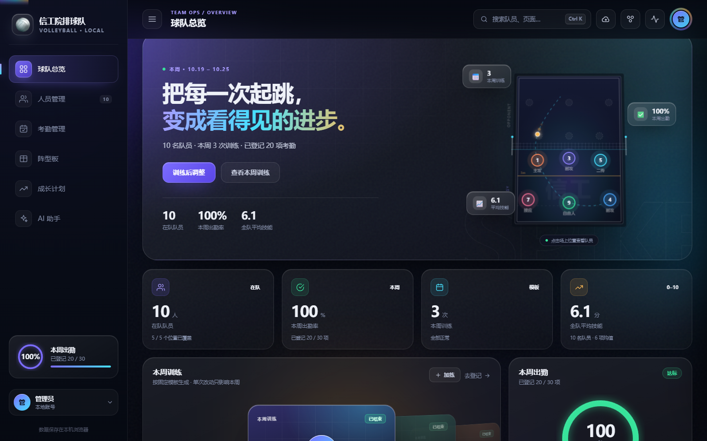
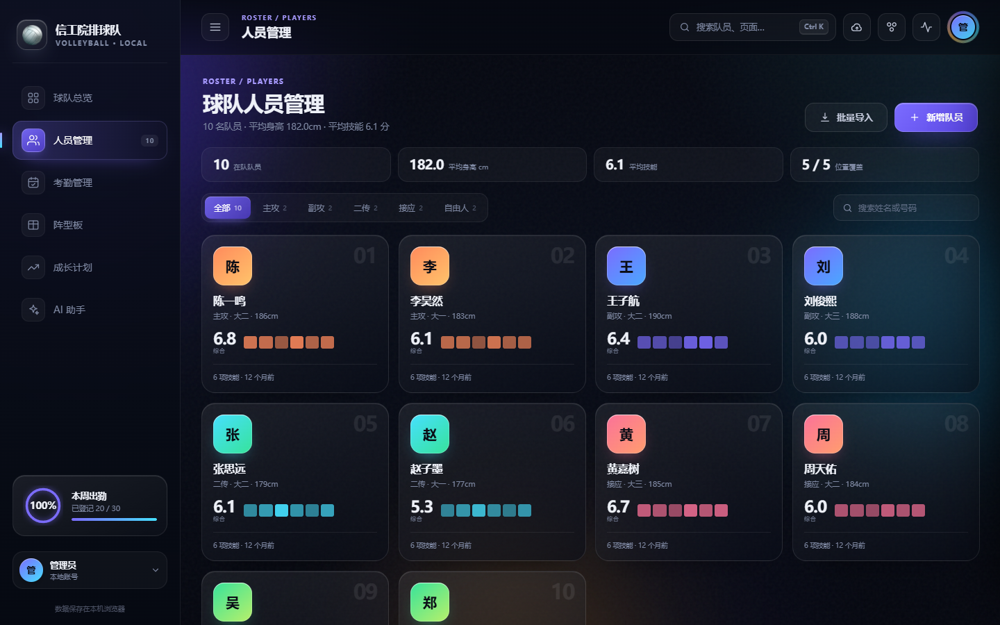
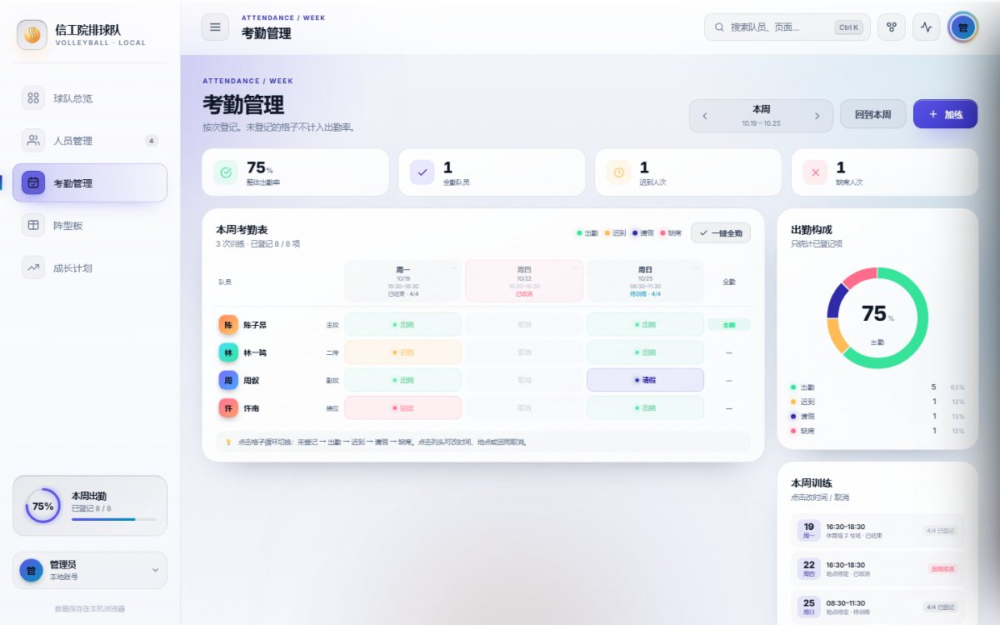
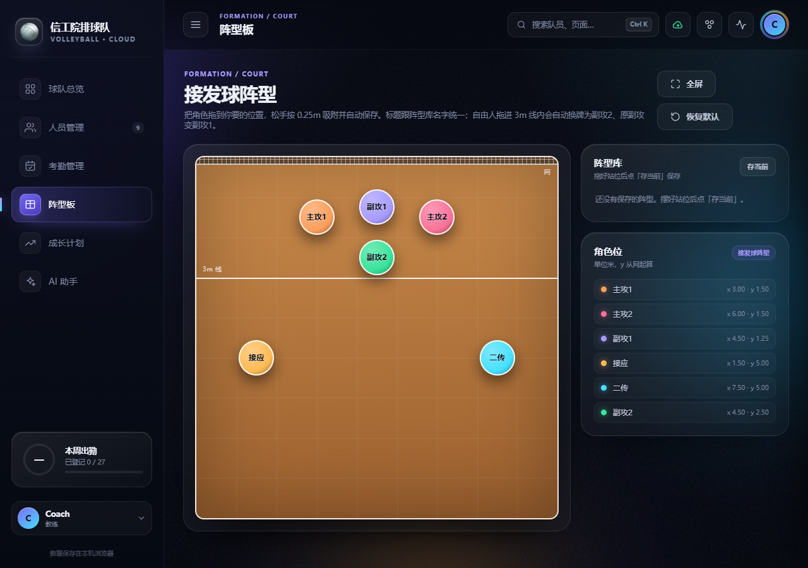
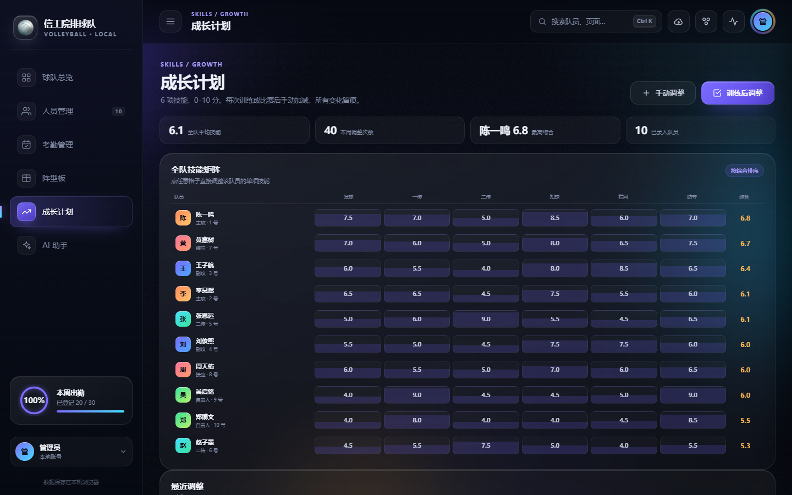
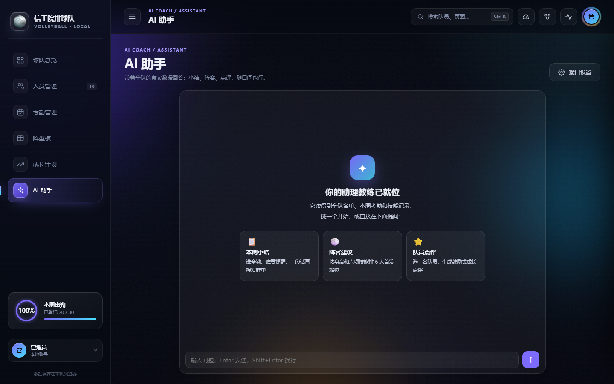
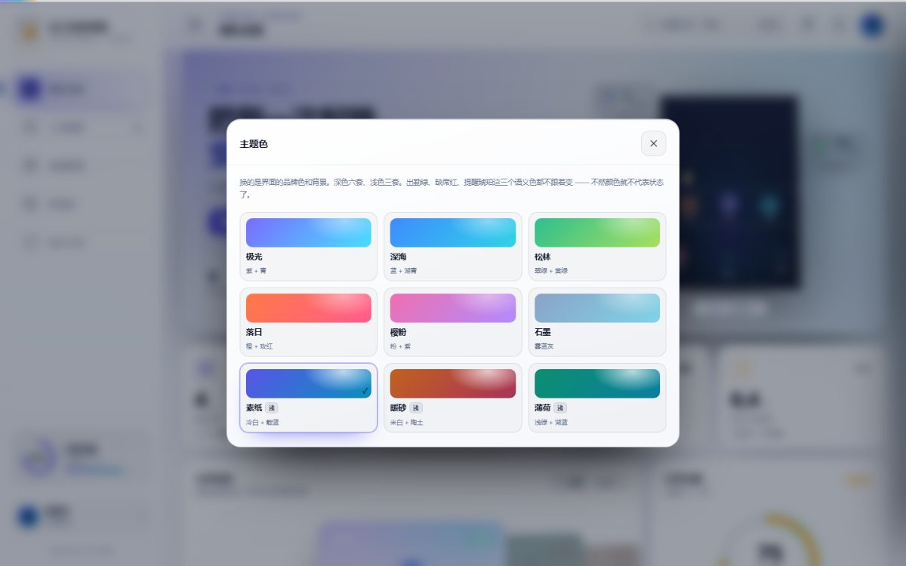
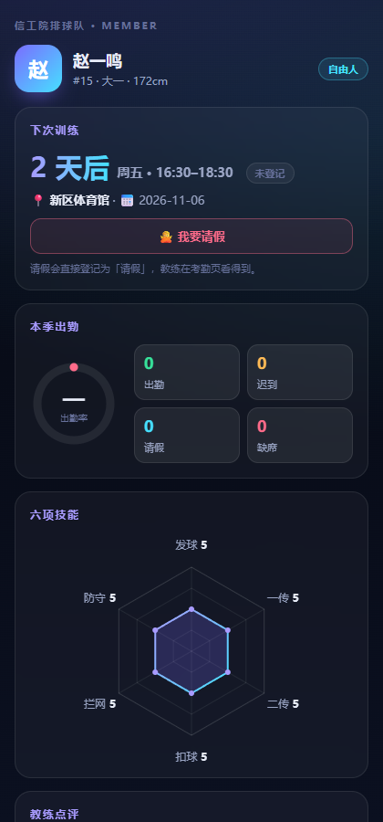

# 排球阵型板 · 球队管理

[](https://github.com/Liao-wenxuan/volleyball-team/actions/workflows/ci.yml)

给高校排球队用的一套本地优先工具：**人员 · 考勤 · 技能成长 · 阵型板**。
纯前端、零依赖，双击一个 HTML 就能用，数据存在浏览器本地，可导出 JSON 备份；
也可以选配 `server/` 里的 Node + SQLite 后端，一键切换成多端同步的云端模式。

三个入口，按你的习惯选：

- **完整版（推荐）** → <https://vb.bscjs.top/> —— 带后端 + 登录 + 多端同步，教练平板和队员手机看同一份数据
- **本地试玩** → <https://liao-wenxuan.github.io/volleyball-team/>（纯前端，数据只存浏览器）
- **下载单文件** → [volleyball-team.html](https://github.com/Liao-wenxuan/volleyball-team/releases/latest/download/volleyball-team.html)（双击就开，不装任何东西）

账号：线上完整版由管理端发放；本地自建后端跑 `npm --prefix server run seed` 可得到演示账号 `demo` / `demo123456`。

数据只存在你自己的浏览器里，随便点、随便拖。



## 为什么做这个

院队日常靠微信群接龙统计训练和考勤，练完之后谁都说不清这学期谁来了几次、谁的一传练上去了。
市面上的球队管理工具是给职业俱乐部做的，注册、付费、云端，对 18 个人的院队是负担。

所以最初的定位很克制：**单机、单用户、不联网**。一个人（队长）维护全队数据，其他人不需要账号。
后来补了可选的云端模式和管理端，但本地优先这条没变——不登录、不联网，功能一个不少。

## 功能

| 模块 | 内容 |
|---|---|
| 球员档案 | 姓名、号码、位置、年级、身高 + 6 项技能（0–10，0.5 步进） |
| 批量导入 | 从 Excel / 在线表 / 群接龙复制一段文本粘贴进来，自动识别列、纠正位置年级写法、拦下号码重复（只查同性别，男队女队可同号）与身高异常，预览勾选后一键建队 |
| AI 助手 | OpenAI 兼容接口（DeepSeek / 智谱 / Kimi…）。本地模式 BYOK 直连、Key 只存本机；云端模式 Key 只存服务器、由服务端代理转发并流式透传，浏览器不接触明文 Key。一键生成本周小结、首发阵容建议、队员点评，流式输出可中断，上下文自动带全队真实数据 |
| 考勤 | 按周 × 每次训练登记，四态循环：出勤 / 迟到 / 请假 / 缺席；未登记不计入出勤率 |
| 训练编排 | 周二 / 周五 / 周日固定模板，单次可改时间地点或标记「因雨取消」 |
| 阵型板 | 半场 9×9m，6 个角色位手指拖动，0.25m 吸附，自动保存；标题跟阵型库名字走；自由人拖进 3m 线内自动换牌「副攻2 / 副攻1」（纯标牌，不动数据）；「存当前」把站位存进阵型库（改名 / 覆盖 / 删除），云端模式整库同步 |
| 成长 | 全队技能矩阵、单人雷达、训练后批量加减、调整记录 |
| 主题 | 9 套（6 深 3 浅），含浅色 |
| 多端 | 云端模式下教练端（平板/电脑）每 15 秒轮询同步，对方改动免刷新可见；队员看数据改走单文件档案导出（`/m` 已停用） |
| 队员档案 | 「分享队伍动态」一键导出**单文件 .html**（全队一份）：队员浏览器打开输姓名+号码看自己的出勤、技能雷达、点评、近 8 次记录，断网可看、不登录、不过服务器；请假在文件里选场次和原因生成回执码发回教练，考勤页「回执」粘贴登记 |

### 云端模式的三端

| 端 | 入口 | 用户 | 能做什么 |
|---|---|---|---|
| 教练端 | `/` | 教练 / 管理员 | 名单、考勤、技能、阵型、AI，全功能 |
| 队员档案 | 单文件 `.html`（导出） | 队员（手机/电脑） | 浏览器打开输姓名+号码看自己的档案，断网可看、不登录；请假生成回执码发回教练。`/m` 手机页已停用（代码保留） |
| 管理端 | `/admin` | 系统管理员（桌面） | 一键建队（自动生成教练账号+一次性密码）、账号重置 / 停用 / 启用、球队概览 |

<p>


</p>
<p>


</p>
<p>


</p>
<p align="center">

</p>

## 快速开始

### 一、下载单文件（只是想用）

点上面的「下载单文件」，得到一个 `volleyball-team.html`（约 762 KB，含三帧加载动画图片）。
双击 → 浏览器打开 → 就能用。

- 不需要装 Node、不需要联网、没有任何依赖，CSS 和 JS 全部内联在这个文件里
- 第一次打开是空的，从首页「添加第一名队员」开始录
- 数据存在浏览器的 localStorage：**换浏览器、清缓存、换电脑都会丢**，设置里可以导出 JSON 备份
- 想发给队友看，直接把文件发过去就行，他打开也是干净的空白数据

> 仓库里那个 `信工院排球队管理系统.html` 和下载下来的 `volleyball-team.html` 是同一个文件，
> 只是发布附件用了英文名，避免下载时文件名变成一串百分号编码。

### 二、在线访问

<https://liao-wenxuan.github.io/volleyball-team/>

省事，但它和单文件版**各存各的数据**——同一个浏览器里，线上版和本地文件的数据不互通。

### 三、改代码

```bash
git clone https://github.com/Liao-wenxuan/volleyball-team.git
cd volleyball-team
npm ci                 # 根目录：playwright-core（只有 e2e 用）
npm ci --prefix server # 后端：Express / SQLite / vitest / tsx
```

用浏览器直接打开 `index.html` 就能调试（它引用同目录的 `style.css` / `app.js`，改完刷新即可）。
改完源码要重新打包成单文件；仓库根目录已经把常用命令收好了：

```bash
npm run build   # 等价于 node build.mjs，重新生成单文件 + 刷 ?v= 版本号
npm test        # 194 条后端单元测试
npm run e2e     # 3 条端到端（真浏览器 → 真前端 → 真后端 → 临时 SQLite）
npm run test:all        # 上面三件一次跑完
```

e2e 在 Windows 上自动复用系统 Edge，不下载浏览器；Linux / CI 上先装一次
`npx playwright-core install chromium --with-deps`，或用环境变量 `E2E_CHROME` 指定可执行文件。

### 四、云端模式（可选，Node + SQLite）

默认是纯本地模式。顶栏的「云」按钮可以切换到云端模式：登录后队员、考勤、技能、阵型
实时同步到自建后端，电脑和平板看到的是同一份数据；不登录则一切照旧。

后端在 `server/`：Node + TypeScript + Express + better-sqlite3 + JWT。

```bash
cd server
npm install
cp .env.example .env   # 改一下 JWT_SECRET
npm run dev            # http://localhost:8787
npm run seed           # 可选：演示账号 demo / demo123456
```

局域网里其他设备（平板）直接访问 `http://<电脑IP>:8787` 也能用同一份云端数据。

> 想部署到公网也可以：`server/` 里带了 Dockerfile（Node 22-slim 多阶段构建）、
> `nixpacks.toml` / `railway.json`（Railway 健康检查配置），任意 Node 托管平台把
> Root Directory 设为 `server`、挂卷到 `/data`、设 `JWT_SECRET` 即可。

API 一览：`POST /api/auth/login`、`GET /api/auth/me`、`GET|POST|PATCH|DELETE /api/players`、`GET /api/weeks/:key` 与 `GET /api/weeks/all`（按模板幂等生成 / 全量拉齐）、`POST|PATCH|DELETE /api/sessions`、`PUT|DELETE /api/sessions/:id/attendance/:pid`、`POST /api/skills/batch`、`GET /api/skills/logs`、`GET|PUT /api/formation`、`GET|PUT /api/formation/library`（阵型库整库同步）、`PUT /api/settings/template|theme|ai`、`POST /api/import`（备份导入事务）、`GET /api/me/summary` 与 `POST /api/me/leave`（队员端）、`POST /api/accounts`（发号）、`GET /api/sync/check`（轮询同步）、`POST /api/ai/chat`（AI 服务端代理，SSE 透传）、`POST /api/auth/register` 已移除——账号一律由管理端发放。

## 几个实现上的取舍

**1. 为什么不用框架**
这个项目的难点在交互和可视化，不在状态规模——全局状态就是一个 `db` 对象，没有跨组件通信。
用原生能精确控制 DOM：点一个考勤格子只改那一个节点，不触发整表重渲染。
代价也清楚：改完数据要手动调 render 函数，页面一多会漏。这是我接受的成本。

**2. 训练数据用「模板 + 单周覆盖」**
不是把每次训练平铺成一张表，而是模板描述规则、周记录只存差异。
改一次训练不会污染以后，取消一次也不会在历史里留下空洞。

**3. 阵型板只做静态摆位**
不做关键帧、不做回放动画。进去、拖六个人、松手保存。
拖动结束即写入，没有保存按钮——多一次点击就多一次打断思路的机会。

**4. 阵型库云端同步用「整库替换」而不是逐条 CRUD**
阵型库一次操作就是增/删/改一条，客户端把整套（≤30 套）推上来，服务端一个事务里删旧写新。
规模小到整库传输不到 20KB，换来的是：无合并冲突、无 id 对不上、接口只有一个。
规模一大这个方案就错了，但 30 套封顶的设计让它永远用不到那一天。

**5. 主题只换品牌色，语义色不动**
9 套主题切换的是 `--violet*` / `--cyan*` 和背景，**出勤绿、缺席红、提醒琥珀恒定**。
颜色一旦跟着主题变，"绿=出勤"这套约定就失效了，那不是换肤，是毁掉信息层。

**6. 零依赖的图表**
雷达图、折线、热力、环形进度全部手写 SVG，没有图表库。

## 测试

**194 条后端单元测试**（vitest + 内存 SQLite，`npm test`，等价于 `cd server && npm test`）。
覆盖按风险排序：鉴权边界（过期/伪造 token、越权、停用账号踢出）、考勤 UPSERT 幂等
（重复登记以最后一次为准、只有一条记录）、批量改技能的事务回滚（半失败全不动）、
跨队隔离（每条 SQL 都按 team_id 作用域）、备份导入的认人规则与脏数据兜底。

**3 条端到端测试**（`node:test` + playwright-core，仓库根目录 `npm run e2e`）：
真浏览器 → 真前端 → 真后端 → 真 SQLite，只盖三条最关键的用户路径——
登录门禁（错密码被拦 / 对密码进云端）、考勤登记（刷新后仍在、服务器确有这条数据）、
阵型板拖拽（松手 0.25m 吸附、站位推送到服务器）。e2e 慢且脆，按金字塔配比只留主干。

测试抓到过一个真 bug：非法 JSON 的请求体会被 body-parser 抛进兜底错误处理返回 500，
正确语义是 400。已修（`errorMiddleware` 识别 `entity.parse.failed`）。

**CI 门禁**：`.github/workflows/ci.yml` 在 push 到 `main` / PR / 手动触发时，于干净的
`ubuntu-latest` 上跑一遍完整链路：`npm ci`（根 + 后端）→ 194 条单测 → `tsc` 编译 →
`npm run build` 并校验单文件产物确实内联了 CSS/JS 和三帧动画 → 安装 Chromium → 3 条 e2e。
顶部那个徽章就是这次跑绿的结果；所以 README 里写的每一条命令，别人 clone 下来都能复现。
`deploy.yml` 不再由 push 直接触发，改成监听 ci 的 `workflow_run` 且只在 `conclusion == success` 时部署——
CI 挂了，那个提交就上不了服务器；手动 `workflow_dispatch` 留作救急通道。

## 性能与稳定性实测

数字都给了可复算的口径，不是估算。

**冷启动体积（2026-11-08，sw v63）**：对首屏必需的四个外链资源
`index.html` / `style.css` / `cloud.js` / `app.js` 做 `zlib.gzipSync(level: 9)` 求和。

| | gzip |
|---|---|
| 启动即加载（当前） | **168.8 KB** |
| 线上 Caddy 实际传输（默认压缩级别） | 182.7 KB |
| 若 5 个模块也塞进启动脚本（r35.16 之前） | 209.1 KB |

线上逐个实测：HTML 38.9 / `app.js` 79.8 / `style.css` 48.0 / `cloud.js` 16.0 KB；
再加三帧加载动画 PNG 56.4 KB（图片不压缩），冷启动合计约 239 KB。
省下的 40.3 KB（约 19%）来自按需加载：`qr.js` / `xlsx.js` / `card.js` / `share.js` /
`playercard.js` 改成 `ensureMod()` 动态注入，只有点开分享、表格导入、队员档案时才下载；
单文件版仍把它们内联回 `app.js` 之前（`file://` 下没法拉外链）。首次加载动画的三帧图
经抠背景 + 调色板量化后合计 **56.4 KB**（原 167 KB）。

**第二轮：少往返、少白下（2026-11-08，sw v63）**。先量后改，实测推翻了一个想当然的
优化：zstd(level 19) 合计 174.3 KB，反而比 gzip(level 9) 的 172.1 KB 大（CSS 尤其明显），
所以 Caddy 保留 `encode gzip zstd`，没去动压缩算法。真正动手的是三处：

- **缓存头**：`vb.bscjs.top` 原先一个 `Cache-Control` 都没有。现在版本化 css/js/png/webmanifest
  是 `public, max-age=31536000, immutable`；`/`、`/index.html`、`/sw.js` 是 `no-cache`
  （SW 必须每次可更新）；`/api/*` 不设头、不受影响。条件请求实测 `304 / 0B`。
- **预缓存瘦身**：SW SHELL 从 12 项 816.6 KB raw 减到 8 项 530.1 KB（-35%）。砍掉的是
  3 张首屏用不到的大图标（187.7 KB）和 `./` 与 `./index.html` 重复下载的那份 HTML
  （gzip 36.8 KB），首次安装少下约 203 KB。大图标改为按需缓存，断网重载实测仍有内容；
  Chrome 做 PWA 可安装性检查仍会自拉一张 21 KB 的 `icon-192.png`，这没法也不该省。
- **并行下载**：`cloud.js` / `app.js` 原本在 body 末尾，慢链路下要等整个 HTML 传完才发请求；
  head 加 `rel=preload as=script` 与 CSS 并行。Playwright 实测 6 个启动资源各只请求 1 次，
  preload 没造成重复下载；单文件版摘掉 preload 标签，避免 `file://` 下白发两次请求。

**重复加载**：r35.12 把 Service Worker 从静态资源「网络优先」改成「缓存优先」，
HTML 保持网络优先、API 完全不缓存，`build.mjs` 每次发版给外链刷 `?v=<sw VERSION>`。
改版前每次刷新都要跨境重下整套脚本（香港链路实测 20–80 KB/s），改版后二次加载静态资源
Chrome 实测 `transferSize = 0`；配合 Caddy 的 immutable，即使 SW 未命中也不再发 304 往返。
发版靠版本号失效，不靠手动清缓存。

**一次真实事故（2026-11-06）**：整机无响应 54 分钟，全站 0 字节超时。
结论不是网络也不是应用：`journalctl` 里 `Under memory pressure` 从 12:01:28 起刷了 252 次，
且**没有 OOM-killer 记录**——是 1.6G 内存机器上同住的 `/opt/vigil` 在跑 Docker build，
`vigil-dashboard-1` 又因 nginx 模板里 `"set" directive is not allowed here` 无限重启。
处置：`docker update --restart=no` + `docker stop vigil-dashboard-1`，实例重启后重跑部署恢复。
顺带得到一个结论：这台机器上不要跑 `docker build`，容器化不是这个项目慢的解法——瓶颈在
跨境链路和内存，不在部署形态。

**当时确实没有任何告警**：这次是自己刷网页发现打不开，不是系统告诉我的。
2026-11-08 补了三层监控，见下一节。

## 可观测性（2026-11-08 补齐）

三层各管一种失败，谁都替代不了谁：

| 层 | 在哪跑 | 抓什么 | 怎么通知 |
|---|---|---|---|
| 外部探活 | GitHub Actions 境外 runner，每 15 分钟 | 整机僵死 / 断网 / Caddy 挂了 | 自动开或复用 `[监控] 站点不可用` issue，恢复后自动评论并关闭 |
| 深度 health | 应用内 `/api/health/deep` | 磁盘满、库不可写、内存见底、备份断更 | 任一子项失败返回 **503**，外部只看 HTTP 码 |
| 内存看门狗 | 服务器 cron 每 2 分钟 | 内存压力苗头（上次事故的真正前兆） | 写 `watchdog.log` + Top RSS 进程快照 + `watchdog.state`，同步进 journal |

**外部探活**（`.github/workflows/monitor.yml`）：探测 `/api/health` 与首页。跨境链路偶尔抖动，
health 连试两次（间隔 5s、单次 20s 超时）才算真失败；首页还要校验 `<title`，
防止反代把错误页当 200 糊弄过去。`workflow_dispatch` 可手动跑，`dry_run` 能验证告警动作
而不真的开 issue。

**深度 health**：`GET /api/health/deep` 返回四项 `checks` 与 `durationMs`：
`database`（`SELECT 1` + `BEGIN IMMEDIATE`/`ROLLBACK` 验证写锁，**不写任何业务数据**）、
`disk`（`statfsSync` 可用空间 ≥ 512 MB）、`memory`（系统可用 ≥ 128 MB + 进程 RSS）、
`backup`（`backups/app-*.db` 最新一份 ≤ 36 小时，忽略 `-wal` / `-shm`）。
浅 health 保持 `{ok,name,time}` 原契约不变——部署脚本和 Caddy 都靠它。
194 条单测里有 6 条专门覆盖这四项判定。

**内存看门狗**（`deploy/watchdog.sh`）：采样 `MemAvailable` / Swap 余量 / load1，
连续 3 次超阈值（默认可用内存 < 200 MB、swap 剩余 < 512 MB、load1 > 4）才告警，
日志附 Top RSS 进程——上次就是靠同类证据定位到 `dockerd` 和无限重启的容器。
**只告警、不自动杀进程**：误杀线上服务比晚几分钟发现更贵。
服务器实测（2026-11-08 11:36）：强制阈值触发 `ALERT` → 恢复触发 `RECOVERED`，
生产 state `status=ok / avail=898MB / swap_used=0 / load1=0.09`，cron 每 2 分钟已挂。

**部署资产入库**：`deploy/` 收了生产 `Caddyfile`、部署脚本、修好的备份脚本和看门狗，
重装机器照着复制即可；改 Caddy 配置记得先 `caddy validate` 再 `reload`。

**局限，别吹成秒级监控**：GitHub Actions 的 cron 会排队（高峰可能延迟十几分钟），
仓库连续 60 天无活动会被 GitHub 暂停定时工作流；看门狗在整机僵死时也会一起停，
所以外部探活才是最后一道。三者都不做自动重启。

## 备份与恢复演练（2026-11-08）

线上每天 03:20 由 cron 跑 `server/scripts/backup.mjs`：用 `better-sqlite3` 的 `.backup()`
在线备份协议拿一致快照（WAL 模式下直接 `cp` 可能拷到半个页），落在
`data/volleyball/backups/app-<时间戳>.db`，保留 14 份。**没演练过的备份等于没有备份**，
所以拿最近一份真做了一次恢复：

1. 把 `app-2026-11-07-19-20-01.db`（159,744 B）从服务器取回本机，以只读方式打开
2. `PRAGMA integrity_check` → `ok`；`PRAGMA foreign_key_check` → 空
3. 行数与现网（对 WAL 做一次 `.backup()` 快照后查）逐表一致：

   | 表 | 备份 | 现网 |
   |---|---|---|
   | teams / users | 2 / 2 | 2 / 2 |
   | players | 22 | 22 |
   | sessions | 9 | 9 |
   | attendance | 59 | 59 |
   | skill_logs | 139 | 139 |

4. 复制一份当 `DB_PATH` 起临时 API（不碰线上库）：`GET /api/health` 返回 200；
   `POST /api/auth/login` 用错密码返回 `401 bad_credentials`（说明服务真的在读这份库，
   不是只回了个静态 ok）；跑完 migration 后各表行数不变

**结论：备份可用性已验证**——能打开、行数对得上、也能被真实服务接管。

演练顺带查出一个真问题：同机另一套 03:10 的通用归档脚本 `backup-db.sh` 遍历 `~/data`
下所有 `*.db`，却只按 basename 命名 tar。两个项目的库都叫 `app.db`，同名 tar 互相覆盖：
解开当天的 `app-20261108-0310.tar.gz`，拿到的是另一个项目的 `posts / products / wallets`，
不是 `players / sessions`。排球项目的数据不依赖这一路（03:20 那套是独立目录、独立命名），
但通用归档当时不可信。

**当天已修复并复验**：`backup-db.sh` 改用父目录名做前缀（`volleyball-app-…` / `csp-app-…`），
并在 `find` 里排除 `*/backups/*`——原来它连应用自己生成的滚动备份也打包一遍，一天多出好几个「备份的备份」。
手动跑一次后两个项目各出各的 tar：排球归档解开是 `players 22 / sessions 9 / attendance 59`、
`integrity_check = ok`，csp 归档是它自己的表，不再串台；cron 未改，旧脚本留了 `.bak` 可回滚。

## 目录

```
index.html                    页面骨架
style.css                     全部样式（含 9 套主题变量）
app.js                        前端全部逻辑，按模块分段
cloud.js                      云端同步模块（登录/拉取/推送/轮询，双模式切换）
build.mjs                     把 CSS / JS / 动画帧内联成单文件，并刷 ?v= 版本号
sw.js                         Service Worker：HTML 网络优先、静态缓存优先、API 不缓存
playercard.js                 队员档案「单文件 .html」导出器（r35）
信工院排球队管理系统.html        构建产物，可直接分发
package.json                  根目录脚本：build / test / e2e / test:all
e2e/e2e.mjs                   3 条端到端测试（node:test + playwright-core）
.github/workflows/ci.yml       CI 门禁：194 单测 + tsc + 构建校验 + 3 条 e2e
.github/workflows/monitor.yml  外部探活：定时探测 + 自动开/关告警 issue
deploy/                       生产 Caddyfile / 部署脚本 / 备份脚本 / 内存看门狗
server/                       可选后端：Express + SQLite + JWT（云端模式）
server/src/health.ts          深度健康检查（db 写锁 / 磁盘 / 内存 / 备份）
server/scripts/backup.mjs     每日在线备份（better-sqlite3 .backup()，保留 14 份）
server/public/admin.html      管理端（/admin）
server/public/m.html          队员端手机页（/m，r35 起停用，代码保留）
docs/interview.md             面试讲点：每个模块的四段式复盘
docs/战术板产品方案.md          阵型板的产品方案
docs/shots/                   README 截图 + GitHub 分享预览图
docs/shots/social-preview.jpg  分享预览图 JPG 版（68 KB）：网页上传用这版，PNG 是源图
LICENSE                       MIT 许可证
prototype/formation-editor.html  阵型板最早的独立原型
```

## 已知限制

- 本机模式下数据只在当前浏览器（localStorage），换设备要手动导出/导入 JSON；云端模式需自建后端
- 云端同步是 15 秒轮询（弱实时），不是 WebSocket 推送；两台设备同时写同一条数据时后写者胜
- AI 聊天记录只存本机（临时工作区），不进云端同步；云端模式下 API Key 存服务器、不回传浏览器
- 监控不是实时的：外部探活 15 分钟一轮且 GitHub cron 会排队，看门狗 2 分钟一轮；三者都只告警、不自动重启服务

## Roadmap

- [x] 阵型库：多套命名保存（改名 / 覆盖 / 删除 + 云端整库同步）
- [x] PWA：可安装到桌面 / 主屏，离线可用（Service Worker 缓存应用壳）
- [x] 多角色：管理端 `/admin` 建队发号；队员看数据改走单文件档案导出（`/m` 手机页停用保留）
- [x] 多端准实时同步（轮询）+ AI Key 服务端代理
- [ ] 阵型导出 PNG，直接发群里讲站位
- [x] 数据上云（Node + SQLite）

## 许可证

MIT，见 [LICENSE](LICENSE)。可以自由使用、修改和分发，保留版权声明即可。
