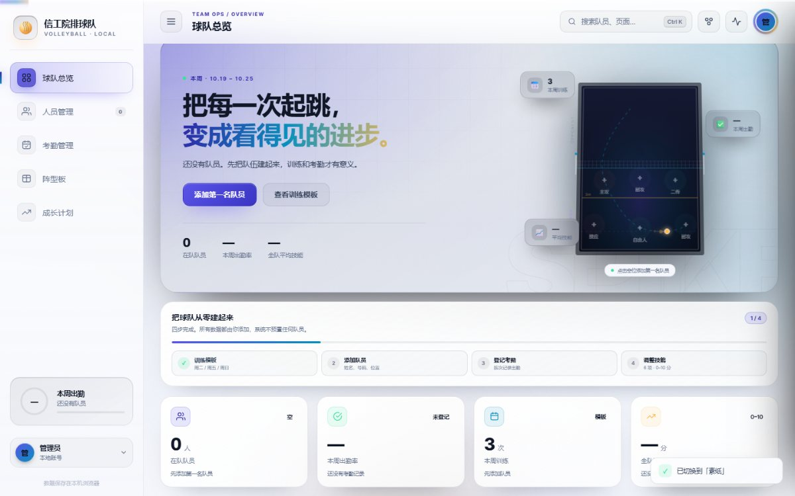
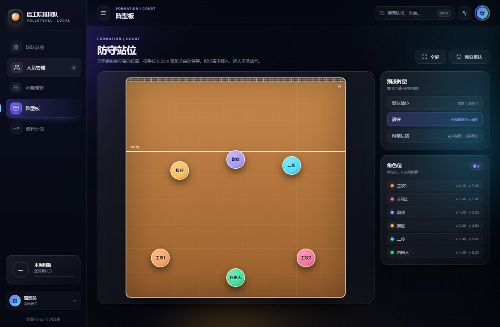
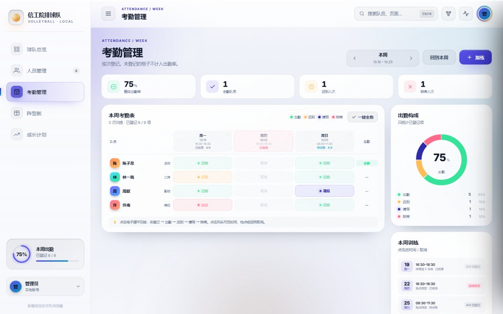
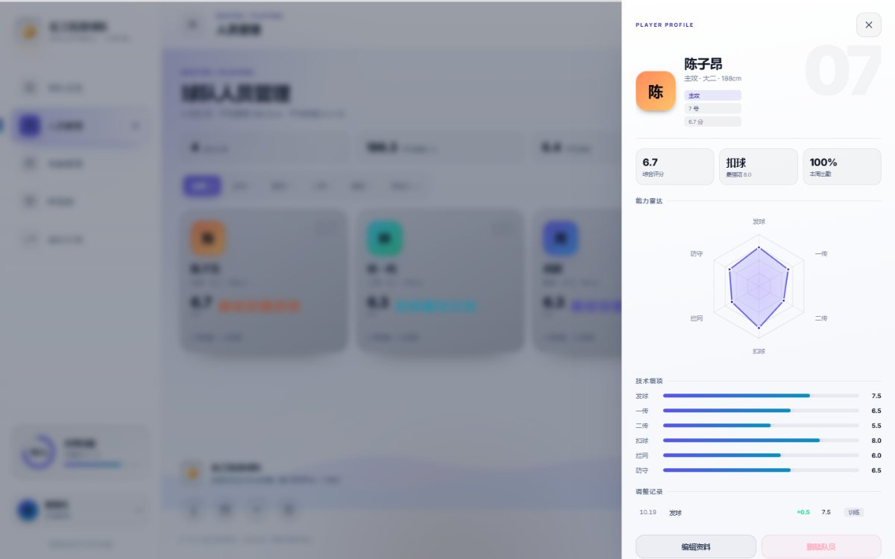
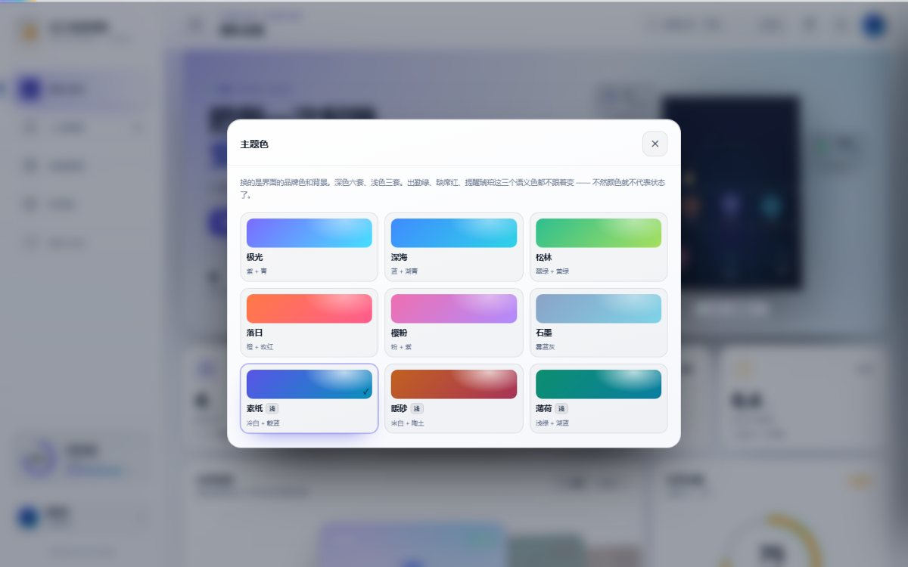

# 排球阵型板 · 球队管理

给高校排球队用的一套本地优先工具：**人员 · 考勤 · 技能成长 · 阵型板**。
纯前端、零依赖，双击一个 HTML 就能用，数据存在浏览器本地，可导出 JSON 备份；
也可以选配 `server/` 里的 Node + SQLite 后端，一键切换成多端同步的云端模式。

两个入口，按你的习惯选：

- **在线试玩** → <https://liao-wenxuan.github.io/volleyball-team/>
- **下载单文件** → [volleyball-team.html](https://github.com/Liao-wenxuan/volleyball-team/releases/latest/download/volleyball-team.html)（双击就开，不装任何东西）

数据只存在你自己的浏览器里，随便点、随便拖。



## 为什么做这个

院队日常靠微信群接龙统计训练和考勤，练完之后谁都说不清这学期谁来了几次、谁的一传练上去了。
市面上的球队管理工具是给职业俱乐部做的，注册、付费、云端，对 18 个人的院队是负担。

所以定位很克制：**单机、单用户、不联网**。一个人（队长）维护全队数据，其他人不需要账号。

## 功能

| 模块 | 内容 |
|---|---|
| 球员档案 | 姓名、号码、位置、年级、身高 + 6 项技能（0–10，0.5 步进） |
| 考勤 | 按周 × 每次训练登记，四态循环：出勤 / 迟到 / 请假 / 缺席；未登记不计入出勤率 |
| 训练编排 | 周二 / 周五 / 周日固定模板，单次可改时间地点或标记「因雨取消」 |
| 阵型板 | 半场 9×9m，6 个角色位手指拖动，0.25m 吸附，三套预设，自动保存 |
| 成长 | 全队技能矩阵、单人雷达、训练后批量加减、调整记录 |
| 主题 | 9 套（6 深 3 浅），含浅色 |

<p>


</p>
<p>


</p>

## 快速开始

### 一、下载单文件（只是想用）

点上面的「下载单文件」，得到一个 `volleyball-team.html`（约 270 KB）。
双击 → 浏览器打开 → 就能用。

- 不需要装 Node、不需要联网、没有任何依赖，CSS 和 JS 全部内联在这个文件里
- 第一次打开是空的，从首页「添加第一名队员」开始录
- 数据存在浏览器的 localStorage：**换浏览器、清缓存、换电脑都会丢**，设置里可以导出 JSON 备份
- 想发给队友看，直接把文件发过去就行，他打开也是干净的空白数据

> 仓库里那个 `信工院排球队管理系统.html` 和下载下来的 `volleyball-team.html` 是同一个文件，
> 只是发布附件用了英文名，避免下载时文件名变成一串百分号编码。

### 二、在线访问

<https://liao-wenxuan.github.io/volleyball-team/>

省事，但它和单文件版**各存各的数据**——同一个浏览器里，线上版和本地文件的数据不互通。

### 三、改代码

```bash
git clone https://github.com/Liao-wenxuan/volleyball-team.git
cd volleyball-team
```

用浏览器直接打开 `index.html` 就能调试（它引用同目录的 `style.css` / `app.js`，改完刷新即可）。
改完源码要重新打包成单文件：

```bash
node build.mjs
```

### 四、云端模式（可选，Node + SQLite）

默认是纯本地模式。顶栏的「云」按钮可以切换到云端模式：登录后队员、考勤、技能、阵型
实时同步到自建后端，电脑和平板看到的是同一份数据；不登录则一切照旧。

后端在 `server/`：Node + TypeScript + Express + better-sqlite3 + JWT。

```bash
cd server
npm install
cp .env.example .env   # 改一下 JWT_SECRET
npm run dev            # http://localhost:8787
npm run seed           # 可选：演示账号 demo@xgy.com / demo123456
```

局域网里其他设备（平板）直接访问 `http://<电脑IP>:8787` 也能用同一份云端数据。

> 想部署到公网也可以：`server/` 里带了 Dockerfile（Node 22-slim 多阶段构建）、
> `nixpacks.toml` / `railway.json`（Railway 健康检查配置），任意 Node 托管平台把
> Root Directory 设为 `server`、挂卷到 `/data`、设 `JWT_SECRET` 即可。

API 一览：`POST /api/auth/register|login`、`GET /api/auth/me`、`GET|POST|PATCH|DELETE /api/players`、`GET /api/weeks/:key`（按模板幂等生成本周训练）、`POST|PATCH|DELETE /api/sessions`、`PUT|DELETE /api/sessions/:id/attendance/:pid`、`POST /api/skills/batch`、`GET /api/skills/logs`、`GET|PUT /api/formation`、`PUT /api/settings/template|theme`。

## 几个实现上的取舍

**1. 为什么不用框架**
这个项目的难点在交互和可视化，不在状态规模——全局状态就是一个 `db` 对象，没有跨组件通信。
用原生能精确控制 DOM：点一个考勤格子只改那一个节点，不触发整表重渲染。
代价也清楚：改完数据要手动调 render 函数，页面一多会漏。这是我接受的成本。

**2. 训练数据用「模板 + 单周覆盖」**
不是把每次训练平铺成一张表，而是模板描述规则、周记录只存差异。
改一次训练不会污染以后，取消一次也不会在历史里留下空洞。

**3. 阵型板只做静态摆位**
不做关键帧、不做回放动画。进去、拖六个人、松手保存。
拖动结束即写入，没有保存按钮——多一次点击就多一次打断思路的机会。

**4. 主题只换品牌色，语义色不动**
9 套主题切换的是 `--violet*` / `--cyan*` 和背景，**出勤绿、缺席红、提醒琥珀恒定**。
颜色一旦跟着主题变，"绿=出勤"这套约定就失效了，那不是换肤，是毁掉信息层。

**5. 零依赖的图表**
雷达图、折线、热力、环形进度全部手写 SVG，没有图表库。

## 目录

```
index.html                    页面骨架
style.css                     全部样式（含 9 套主题变量）
app.js                        前端全部逻辑，约 2.4k 行，按模块分段
cloud.js                      云端同步模块（登录/拉取/推送，双模式切换）
build.mjs                     把四者内联成单文件
信工院排球队管理系统.html        构建产物，可直接分发
server/                       可选后端：Express + SQLite + JWT（云端模式）
docs/战术板产品方案.md          阵型板的产品方案
docs/shots/                   README 截图
prototype/formation-editor.html  阵型板最早的独立原型
```

## 已知限制

- 本机模式下数据只在当前浏览器（localStorage），换设备要手动导出/导入 JSON；云端模式需自建后端
- 一个邮箱账号对应一支球队，暂不支持多队切换与多人协作
- 阵型板暂不支持多套阵型命名保存，只有一套当前站位 + 三套预设

## Roadmap

- [ ] 阵型库：多套命名保存、按标签筛选
- [ ] 阵型导出 PNG，直接发群里讲站位
- [x] 数据上云（Node + SQLite）
