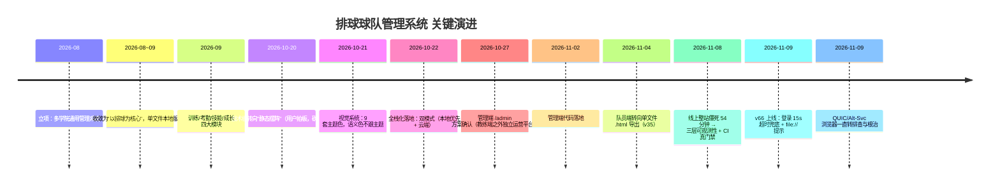
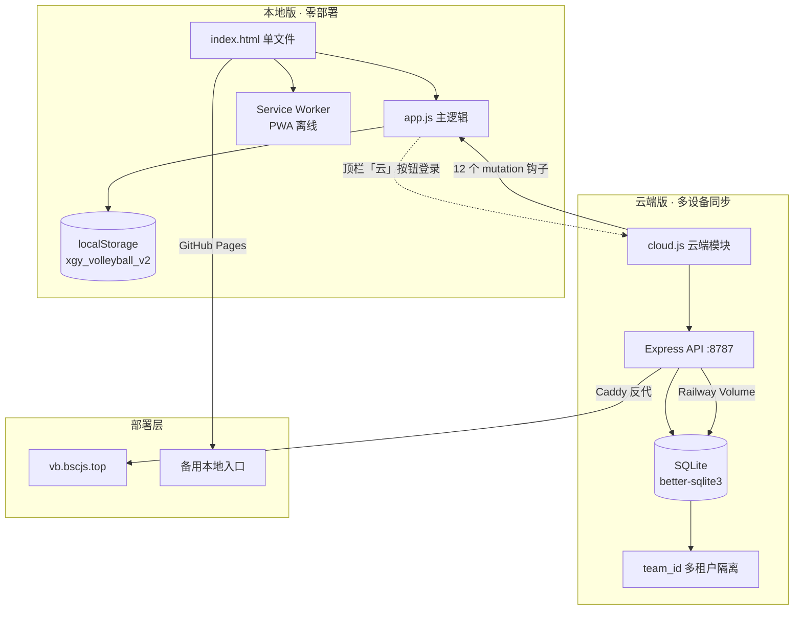
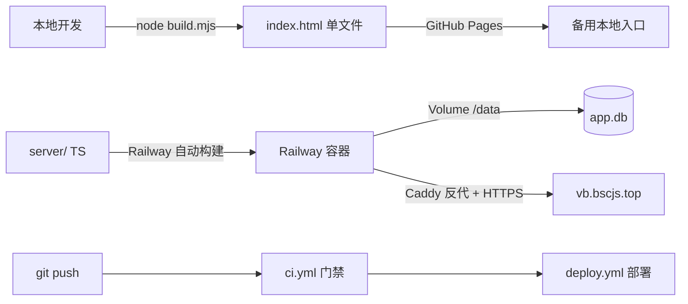

# 从零到一 · 排球球队管理系统搭建全解析

> 这份文档回答的是面试官那类问题："你这个项目是怎么做出来的？""每一步为什么这么决策？"
> 按时间线和模块两条线展开：先讲**怎么从想法收敛成方案**，再讲**每个核心模块从问题到实现**。
> 配 `面试问题全景.md` 一起看——那份是"会被问什么"，这份是"我是怎么做的"。

---

## 1. 项目缘起与需求收敛

### 1.1 起点比现在大得多
项目最初想做的是"**多学院通用管理系统**"——一个能套给任何学生组织用的模板。
做了不久就发现：通用系统的差异化极低，而我对"排球"这个具体领域的理解才是真壁垒。

### 1.2 收敛决策（关键一步）
和用户对齐后，项目**收敛为"以排球为核心"**，砍掉通用外壳，聚焦三个有排球特色的功能：
- **平板端战术模拟**：拖队员图标摆跑位（这是通用系统做不出来的）。
- **训练 / 考勤 / 技能成长**：排球队真实的管理痛点。
- **队员端档案**：队员看自己数据 + 请假。

**为什么这一步重要**：它没有增加代码量，却让项目从"又一个 CRUD"变成"一个懂排球的工具"。
面试讲"做减法"比讲"做了很多"更显成熟。

### 1.3 功能边界（和用户逐条确认的，不再猜）
| 模块 | 规则要点 |
|---|---|
| 训练 | 周二/周五 16:30–18:30，周日 08:30–11:30；下雨手动标「因雨取消」，不计入出勤率；单次变动只影响当周，不回写模板；训练不记主题 |
| 队员 | 6 字段：姓名/号码/位置/年级/身高/性别（性别后加）；位置固定 5 种：主攻/副攻/二传/接应/自由人 |
| 号码 | **只在同性别内唯一**，男队女队可同号（真实队规，不是数据库约束） |
| 考勤 | 4 态：出勤/迟到/请假/缺席；迟到计入出勤但单独统计 |
| 技能 | 6 项固定：发球/一传/二传/扣球/拦网/防守；0–10、可 0.5；新队员默认 5.0 |
| 比赛 | **已删除**，不要复活 |
| 成长 | 全队矩阵（点格调）+ 队员雷达 + 训练后批量调整 + 调整记录 |
| 数据 | **全部由用户从零录入**，不塞任何演示数据；空状态必须有引导按钮 |
| 删除 | 删队员、删已有考勤的训练，都要二次确认 |

**协作红线（贯穿全程）**：用户明确要求"不要乱做，有不懂的先问"，且要先预览再写代码；
改动前先对齐，不自作主张扩功能。所以文档里每个"为什么不做 X"都有出处。

---

## 2. 关键技术决策时间线

> 时间线来自 git/CHANGELOG/工作日志，是真实演进，不是事后编排。



**几个影响架构的转折点**：
- **v29 登录态按标签隔离**：同浏览器两个标签各登一个队——这个需求是后来才有的，倒逼存储分层重构。
- **v35 队员端转向**：从"发账号"改成"导出单文件 HTML"，零后端依赖。
- **双模式（v22）**：确认"默认本地、登录切云端"，本地逻辑一行不动，只在 12 个 mutation 点挂钩。

---

## 3. 架构总览

### 3.1 三层结构



**核心设计思想**：UI 只有一套（`app.js`），数据层**可插拔**——
本地模式数据走 localStorage，云端模式数据走 `cloud.js → API → SQLite`。
它们之间不是"两套应用"，而是"同一界面换数据后端"。

### 3.2 双模式切换原理
- 默认渲染即用本地版，所有写操作落 localStorage。
- 顶栏「云」按钮 → 登录弹窗 → 成功后在 `sessionStorage` 写登录态（token/user/team/role 四个 key 整组同层）。
- `cloud.js` 启动 `pullCore()` 整份覆盖本机（**登录云端后服务器是唯一权威**）。
- 之后所有 mutation：增删改走"服务器先行取 id"，高频操作走"本地先行 + 后台推送，失败回拉"。

### 3.3 模块地图（前端）
| 文件 | 职责 |
|---|---|
| `app.js` | 主逻辑：db 抽象、渲染调度、训练/考勤/技能/成长 UI |
| `cloud.js` | 云端模块：12 个 mutation 钩子、登录、同步、pullCore |
| `courtcard.js` | 阵型导出 PNG（按需加载） |
| `playercard.js` | 队员档案单文件 HTML 导出 |
| `card.js` | 卡片通用逻辑 |
| `qr.js` | 请假回执码 |
| `share.js` | 分享/导出 |
| `xlsx.js` | 表格导入 |
| `sw.js` | Service Worker，`VERSION` 是唯一真源 |
| `style.css` | 暗色玻璃拟态 + 紫/青/琥珀，9 套主题 |

后端（`server/src`）：`app/auth/db/repo/security/health/http/defaults/seed/passwords/index`
+ `routes/`（13 个：accounts/admin/ai/auth/formation/health/import/me/players/sessions/settings/skills/sync）。

---

## 4. 核心模块从零实现

每个模块按 **问题 → 方案 → 关键实现点** 三段讲。

### 4.1 单文件前端 + 内联构建
- **问题**：教练要"双击就能用、没网也能记"，不能让人装 Node、不能依赖 CDN。
- **方案**：开发时多文件（`index.html` + `style.css` + 多个 `.js`），发布时 `build.mjs` 把它们**内联**进一个 `index.html`。
- **关键实现**：
  - `build.mjs` 解析 HTML 模板，把 `<link>`/`<script src>` 替换为内联 `<style>`/`<script>`。
  - 同时读取 `sw.js` 的 `VERSION`，刷新所有资源引用的 `?v=N`（保证缓存失效）。
  - 按需模块（`courtcard.js` 等）在 `MODS` 映射注册，`build.mjs` 的 `lazyMods` 和 `ASSET_RE` **两处都要登记**，漏一边就 404。

### 4.2 数据模型与状态层
- **问题**：单队几十人，状态不复杂，但要保证"所有写可追踪、可同步、可清洗"。
- **方案**：前端单一 `db` 对象，所有写走 `db.xxx()` 方法（集中 mutation 点），方法内做
  "更新内存 + 落 localStorage +（云端）触发钩子"三件事。
- **关键实现**：
  - `normalizeDB`：每次读取用白名单清洗，防止旧版本字段污染新代码（**每加一个持久化字段，
    `blankDB` 和 `normalizeDB` 必须成对改**——这个坑踩了三次）。
  - 后端对应：多表带 `team_id`；技能 6 个 REAL 列；考勤 `(session_id, player_id)` 复合主键 UPSERT；
    `players.id` 是**全局主键**，导入时 `newId` 重生成。

### 4.3 训练与考勤
- **问题**：微信群接龙统计出勤既慢又易错，且场馆常没信号。
- **方案**：训练按周模板 + 单次变动（只影响当周，不回写模板）；考勤 4 态格子，点击即落库。
- **关键实现**：
  - 下雨取消：手动标「因雨取消」，不计入出勤率分母。
  - 迟到：计入出勤但单独统计——语义上是"人来了"，但纪律单列。
  - 高频点格：云端模式防抖 + 本地先行，保证"没网也能记"。

### 4.4 技能矩阵与成长页
- **问题**：队员技能成长没记录，教练凭印象排兵。
- **方案**：全队 6×N 矩阵（点格调分），队员雷达图，训练后批量调整，调整记录可追溯。
- **关键实现**：技能 6 固定项、0–10 可 0.5、新队员默认 5.0；批量调整走事务，记录每次变动的人和值。

### 4.5 战术板（静态摆阵）
- **问题**：战术靠脑子记、靠口头讲，没法让队员"看到"站位。
- **方案**：平板端拖 6 个角色位（自由人/主攻1/主攻2/副攻/接应/二传，绑角色不绑真人）摆防守站位。
- **关键实现**：
  - **用户明确"静态摆阵，不是动画"**——所以没有时间轴、没有回放、没有 GIF/MP4。
  - 拖拽只在内存跟手，松手才落库；云端 600ms 防抖合并推送。
  - 0.25m 网格吸附，松手结算。
  - `courtcard.js` 导出 PNG（按需加载）。
  - 首屏视觉就是这个 SVG 战术板（不是排球实物图），契合"懂排球"的定位。

### 4.6 双模式云端
- **问题**：教练多设备（手机记、平板看、电脑汇总）数据要同步，但不想强制所有人部署后端。
- **方案**：默认本地；登录云端后切 Node/SQLite 后端。
- **关键实现**：
  - `cloud.js` 是独立云端模块，`app.js` 本地逻辑一行未动，只在 12 个 mutation 点挂钩。
  - 写策略分两类：增删改服务器先行取 id；高频操作本地先行 + 后台推送，失败回拉以服务器为准。
  - 训练周数据云端懒加载（不一次性拉全量）。

### 4.7 登录门禁与限流
- **问题**：教练端要有访问控制，且要防暴力破解。
- **方案**：JWT 鉴权 + 「IP + 用户名」连续失败限流（超 5 次锁 15 分钟，429）。
- **关键实现**：
  - token 存 `sessionStorage`（每标签一份），localStorage 只作新标签默认身份；四个 key 整组同层读。
  - 限流**按账号隔离**——假账号被锁不影响真实账号（实测验证过）。
  - v66 给登录请求加 15s `AbortController` 超时兜底 + file:// 提示（解决无响应卡死）。

### 4.8 队员端档案导出（单文件 HTML）
- **问题**：给队员发账号 = 账号体系 + 权限 + 登录成本，而队员只想要"看自己 + 请假"。
- **方案**：教练导出一份全队 `.html`，队员用"姓名 + 号码"进门，请假走回执码。
- **关键实现**：
  - `playercard.js` 导出全队一份 `.html`；进门校验姓名+号码。
  - 回执码逻辑与 `share.js` 逐位一致（改一边必须重跑 `node preview/test-playercard.mjs` 验证）。
  - `cardRuntime` 由 `toString()` 内联，**runtime 内不得引用外层变量**；数据 JSON 里 `<` 必须转义。

### 4.9 管理端 /admin（多球队运营）
- **问题**：用户（admin）要运营多个球队，给每个队建教练账号。
- **方案**：独立页面 `/admin` + 独立登录（`requireSysAdmin`），与教练端账号体系分开。
- **关键实现**：
  - 一键建队（队名 + 教练 → coach 账号 + 一次性密码 + 默认模板站位）。
  - 教练账号管理（重置/禁用/启用/改名）；停用可恢复不删除。
  - 概览：队员数 + 本周训练 + 最近活跃 + 出勤率 + 近 4 周趋势。
  - `auth.ts` 抽 `verifyUser`（无 team 解析）防管理端自锁。

### 4.10 AI 助手（本地直连 + 云端代理）
- **问题**：教练想要"本周小结/阵容建议/队员点评"的 AI 辅助。
- **方案**：双轨——
  - 本地模式：浏览器直连 OpenAI 兼容 `/chat/completions`，SSE 流式，Key 存 localStorage（不经任何中间方）。
  - 云端模式：Key 只存服务端 `team_settings.ai`，浏览器发 messages 给 `POST /api/ai/chat`，
    服务端带 Key 请求上游并把 SSE **原样透传**，前端解析零改动。
- **关键实现**：
  - 掩码返回 `••••••••••`，保存时前端交回掩码则服务端保留原值（Key 永不回传浏览器）。
  - 踩坑：最初挂 `req.on('close')` 导致请求体读完就 abort 上游（Node 18+ 语义），正确是挂 `res.on('close')` 且 `!res.writableEnded`。

---

## 5. 工程化体系

### 5.1 测试分层（数字以磁盘为准）
- **199 个后端单测**（11 个文件，node:test + 真 SQLite 临时库）：路由、repo、鉴权、导入事务。
- **39 个纯函数单测**（2 个文件）：数据归一、merge 语义、考勤计算。
- **3 个 e2e**（真浏览器 Edge → 真前端 → 真后端 → 真 SQLite）：登录门禁、考勤落库、阵型拖拽推送。

### 5.2 e2e 架子关键设计
- 动态空闲端口（避免上一轮残留进程被误连 → 否则**静默跑在旧库上**，症状像业务 bug）。
- 不经 shell 直接 `process.execPath + tsx/dist/cli.mjs` 起后端。
- `taskkill /T /F` 递归杀进程树。
- health 未就绪即红。

### 5.3 CI/CD 真门禁
- `ci.yml` 跑 `test:all`（后端单测 + 纯函数 + build + e2e）。
- `deploy.yml` 监听 `ci.yml` 的 `workflow_run` 且 `conclusion==success` 才部署；`workflow_dispatch` 留救急。
- 根 `package.json` + 锁文件保证 `npm ci && npm run test:all` 可复现。

### 5.4 安全头自研（不装 helmet / express-rate-limit）
- 自研 `security.ts`：CORS / 防盗链 / 登录限流。
- **CSP 永远不下发**：三端内联脚本会因 CSP 白屏。5 条测试锁死"不装这两个依赖"。

---

## 6. 部署链路



- **Railway**：Root Directory=`server`，Volume 挂 `/data` + `DB_PATH=/data/app.db`，环境变量 `JWT_SECRET`；
  含 `nixpacks.toml` / `railway.json`（healthcheck `/api/health`）。
- **Caddy**：自动 HTTPS；**隐患**是会下发 `Alt-Svc: h3` 让浏览器走 HTTP/3（见第 7 节事故 2）。
- **GitHub Pages**：托管的本地版是云端挂掉时的备用入口（不能同步云端数据）。
- **部署脚本** `deploy/deploy-volleyball.sh` 入库，确保新增 js 自动 `cp` 同步到服务器
  （含 `[ -d assets ] && cp -rf assets/. "$WEB/assets/"` 同步新图片资源）。

---

## 7. 踩坑档案（真实事故，面试讲透加分）

### 7.1 整站僵死 54 分钟（2026-11-08）
- **现象**：线上整站无响应，靠用户刷网页才发现。
- **定位**：一台监控容器（`/opt/vigil`）Docker build + 无限重启，吃光内存，
  journal 252 次 `Under memory pressure` 却没有 OOM-killer，把 API 进程挤死。
- **根治**：三层可观测性——
  1. `/api/health/deep`：DB 写锁 / 磁盘 / 内存 / 备份新鲜度。
  2. 服务器内存看门狗：每 2 分钟、连续 3 次才告警、只告警不杀。
  3. GitHub Actions 外部探活：自动开/关 issue，把"用户发现"变成"系统发现"。

### 7.2 浏览器一直转（QUIC/Alt-Svc 陷阱，2026-11-09）
- **现象**：用户说"浏览器里一直转"，curl 测一切正常。
- **定位**：Caddy 下发 `Alt-Svc: h3=":443"`，Chrome 30 天内优先 HTTP/3（QUIC/UDP 443），
  跨境 UDP 被丢 → 一直转或 `ERR_CONNECTION_RESET`。失败时 SW 又回退缓存的旧 HTML（v65 的 `cloud.js`
  还没 15s 超时），登录弹窗永久停在"登录中…"。
- **验证**：真浏览器对照实验——默认 0/4、禁用 QUIC 4/4。
- **根治**：服务端关掉 HTTP/3、不再下发 Alt-Svc（属于生产配置变更，需走部署通道 reload）。

### 7.3 file:// 单文件版连云端会挂（v66 修复）
- **现象**：双击本地 `index.html`（file://）或内置预览点「云」登录，永远"登录中…"。
- **原因**：不透明源下浏览器把跨站请求挂住，连 `GET /api/health` 都零响应。
- **修复**：`cloud.js` 的 `api()` 加 15s 超时兜底 + 页面提示"请用同源线上完整版登录"。

### 7.4 备份恢复演练抓到真 bug
- **现象**：通用归档按 basename 命名 tar，两个项目的 `app.db` 互相覆盖。
- **修复**：改成带父目录前缀 + 排除滚动备份目录，并用副本起临时 API 验证可恢复。

---

## 8. 项目地图与现状数据

```
volleyball-team/
├── index.html          单文件产物（约 100KB，gzip 更小）
├── style.css           9 套主题，暗色玻璃拟态
├── app.js              主逻辑（db 抽象 + 渲染 + 训练/考勤/技能/成长）
├── cloud.js            云端模块（12 mutation 钩子 + 登录 + 同步）
├── courtcard.js        阵型导出 PNG（按需）
├── playercard.js       队员档案单文件导出
├── card.js / qr.js / share.js / xlsx.js
├── sw.js               VERSION=v66 唯一真源
├── build.mjs           内联构建
├── server/             Node22 + TS + Express + better-sqlite3 + zod + JWT
│   ├── src/            13 个模块 + routes/(13 个路由)
│   └── test/           199 后端单测
├── tests/              39 纯函数单测
├── e2e/                3 e2e 场景
├── deploy/             Caddyfile + deploy-volleyball.sh（脱敏入库）
├── docs/               方案/讲法/清单
└── preview/            验收与排查脚本
```

**规模数据（实测）**：
- 前端核心 4 文件（app.js + cloud.js + style.css + index.html）约 10,300 行。
- 后端 `server/src` 约 3,600 行 TS。
- 测试：199 后端单测 + 39 纯函数 + 3 e2e。
- 单文件 `index.html` 约 100KB；版本 `VERSION=v66`。

---

## 9. 给"从零复刻"者的建议

1. **先定形态，再定技术**："双击即用 + 离线"这个形态直接决定了单文件 + 原生 JS，而不是反过来。
2. **数据层先抽象**：所有写操作集中到 `db.xxx()`，后面挂云端钩子、做同步才不痛苦。
3. **业务约束来自用户，不是数据库**：号码同性别唯一、迟到计入出勤——这些规则是队长给的，
   凭空收紧等于给用户制造错误。
4. **PWA 版本控制要早设计**：`VERSION` 当唯一真源，build 同步刷 `?v=N`，否则用户永远拿不到新版。
5. **可观测性不是奢侈品**：线上僵死 54 分钟才加监控，这个代价本可以避免——新项目第一天就该有 health + 外部探活。
6. **诚实讲 AI 辅助**：后端 AI 辅助完成度高没问题，但架构、安全、同步逻辑、验收必须自己掌控，讲的时候不夸大不隐瞒。

---

> 配套文档：`面试问题全景.md`（按面试官提问角度组织的 Q&A）。
> 模块级"四段式"讲法见 `docs/interview.md`。
